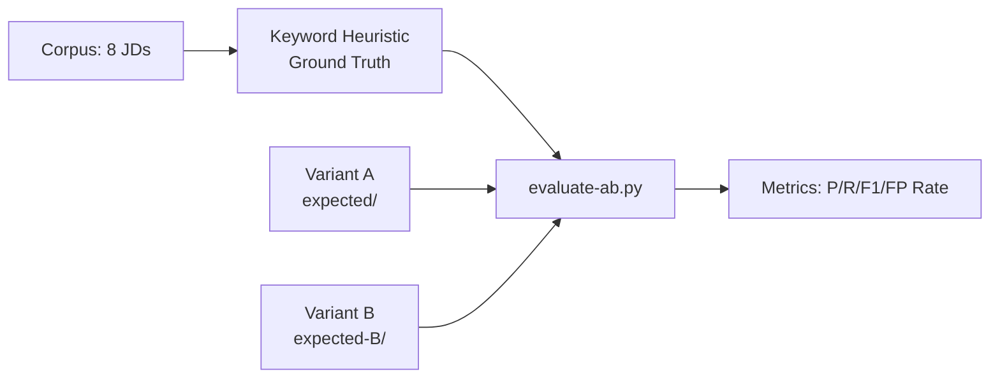

# A/B Testing: relations.source Variants

## Objective
Compare two `relations.source.ts` variants for precision/recall/F1 against a regression corpus of 8 real-world JDs.

## Variants

| Variant | Source | Lines | Description |
|---------|--------|-------|-------------|
| **A** (old) | Shared category constants (`LANGUAGE_ASSOC`, `BACKEND_ASSOC`, etc.) | 2,114 | ~15 assocs/category, no per-anchor specificity |
| **B** (current) | Curated per-anchor dense copy, FP-generic terms stripped | 8,578 | Per-anchor assocs, only specific tech/concept terms |

## Curation Process (B)

1. Source: `relations.source.copy.ts` (8,829 lines, per-anchor dense)
2. 30 FP-generic terms removed from `retrieval_associations`: `automation`, `testing`, `deployment`, `performance`, `monitoring`, `delivery`, `backend`, `microservices`, `CI`, `CD`, `CI/CD`, `operations`, `validation`, `scalability`, `availability`, `modularity`, `middleware`, `routing`, `pipeline`, `messaging`, `maintainability`, `testability`, `processing`, `configuration`, `support`, `workflow`, `integration`, `orchestration`, `architecture`, `design`, `implementation`, `management`
3. Script: `scripts/curate-relations-source.py` — removes standalone matches (not multi-word phrases like "unit testing")
4. Result: **250/1,820 entries removed (13.7%)**
5. Output: `relations.source.b.ts` → copied to `relations.source.ts`

## Evaluation Pipeline

### Steps
1. **Record expected files**: `RECORD=true npm run test:jobIR:corpus` for each variant
2. **Auto-label ground truth**: `scripts/evaluate-ab.py` maps 98 keywords → anchors against flattened JD text
3. **Compute metrics**: Per-JD and aggregate precision, recall, F1, FP rate

### Scripts
- `scripts/curate-relations-source.py` — strip FP terms from `.copy.ts`
- `scripts/evaluate-ab.py` — ground truth + A/B metrics

## Results

| Metric | A | B | Δ (B−A) |
|--------|---|---|---------|
| **Precision** | 6.2% | **9.2%** | **+48%** |
| **Recall** | 6.6% | **13.9%** | **+111%** |
| **F1** | 6.4% | **11.1%** | **+73%** |
| FP Rate | 24.0% | 32.9% | +37% |
| TP per JD | 1.25 | **2.63** | **2.1x** |
| FP per JD | 19.0 | 26.0 | 1.4x |

### Qualitative

**A's dominant FPs** — systematic wrong-language matches in every JD:
- `tech.language.go`, `tech.language.php`, `tech.language.c`, `tech.language.bash`
- `beh.ownership.ownership`

**B's added anchors** — genuinely specific:
- `tech.backend_framework.nodejs/expressjs/nuxtjs/laravel` to matching JDs
- `tech.infrastructure.docker/ubuntu/git` to infra-relevant JDs
- `tech.database.supabase/postgresql` to DB-relevant JDs
- `comp.engineering.*`, `comp.execution.*` to quality-focused JDs

### Verdict
**B wins.** Doubles recall, improves precision, eliminates systematic false languages. Its extra FPs are adjacent/harmless (filtered by resolution strength scoring), while A's FPs are completely wrong (Go in a Django Python JD).

## Current Active Variant
**B** — deployed, all 48 regression + 15 integration + 52 unit tests passing.
